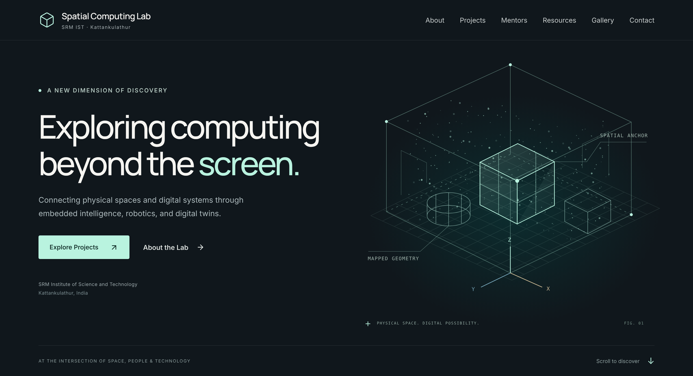
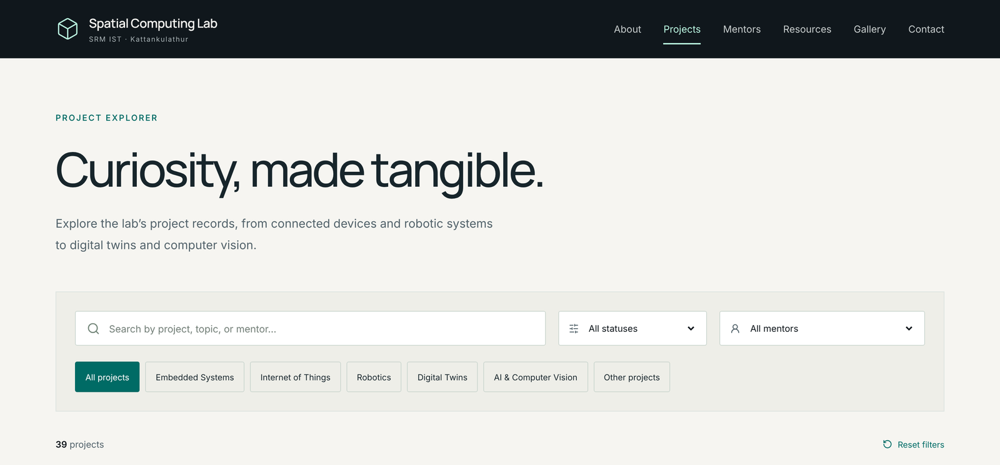

# Spatial Computing Lab · SRMIST

The website I'm building for the Spatial Computing Lab at SRM Institute of Science and Technology, Kattankulathur. It brings the lab's brochure, project board and faculty project list into one site, so students and collaborators can see what the lab works on and who to talk to.

**Status: in progress.** The [preview](https://srm-spatial-computing-lab.vercel.app) is live. The site hasn't launched yet, and some content is still waiting on the lab's confirmation.



## What's on the site

- **Projects:** 39 lab projects across embedded systems, IoT, robotics, digital twins and computer vision, each with its own page. Search and filter by category, status or mentor; filters live in the URL, so a filtered view can be shared as a link.
- **Mentors:** 11 faculty mentors, each linked to the projects they guide.
- **Resources:** the lab brochure, plus starting points for WebXR, three.js, OpenCV, Unity XR and more.
- **Gallery:** photos of the lab and of prototypes from the project board.
- **Contact:** an enquiry form that drafts an email in the visitor's own mail app. The site doesn't send or store anything.



## How it's built

- React 19, TypeScript and Vite, with React Router for client-side routes. Deployed on Vercel.
- `src/lib/catalog.mjs` merges project records from the three source documents into one list and matches faculty names across the different spellings those documents use.
- The hero scene is an SVG diagram with a light pointer parallax, so it needs no WebGL. Motion is switched off for visitors who prefer reduced motion.
- Accessibility: a skip link, focus moved to the new page on navigation, a keyboard-friendly mobile menu, and form errors tied to their fields.
- Photos are served as responsive WebP variants.

## Run it locally

Needs Node 24.

```bash
npm ci
npm run dev      # http://127.0.0.1:5173
npm run build    # type-check, then build to dist/
```

## Project structure

```text
src/
  pages/        one component per route
  components/   shared UI and the SVG scene
  data/         lab content as JSON, assembled in content.ts
  lib/          pure helpers for merging records and filtering
public/         images and the lab brochure (PDF)
```

Content comes from documents supplied by the lab. Built by [Abhilash Kar](https://abhilashkar.dev/).
